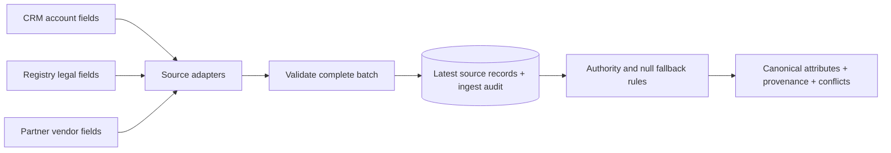

# Multi-source entity platform

**Three systems disagree about one supplier. Which value should an application use—and can we explain why?**

This project reconciles fictional CRM, registry, and partner feeds into a canonical supplier view. Every selected attribute includes its origin, competing values, and a conflict flag. Source-specific adapters keep upstream field names out of the core model.

## Try it in one minute

Requires Python 3.9+ with SQLite. No packages, cloud account, credentials, or external data required.

```bash
python3 entity_platform.py
python3 -m unittest discover -s tests -v
```

The demo chooses **Juniper Workshop Supply** and **Boulder** from the registry, but falls back to **Equipment** from the CRM because the registry has no classification. The competing values remain visible. Names and records are invented.

To retain state and demonstrate replay:

```bash
python3 entity_platform.py --db entities-demo.db
python3 entity_platform.py --db entities-demo.db
```

The second ingestion reports three unchanged records. Inspect `examples/source_feeds.json` for the three different upstream contracts; `examples/suppliers.jsonl` shows their canonical equivalents.

## Architecture



## Engineering decisions

| Decision | Reason and tradeoff |
|---|---|
| Explicit supplier identity | Avoids pretending that similarly named organizations are the same. Identity linking is an upstream input; fuzzy matching is outside this example. |
| Source authority before recency | A newer marketing name should not automatically override a registry's legal name. Revisions track freshness within each source. |
| Preserve competing values | Consumers can inspect disagreement instead of losing evidence during a merge. |
| Null means unknown | A higher-authority null falls back to another source. Explicit deletion/tombstone semantics would need a separate contract. |
| Reject conflicting equal revisions | Silent last-write-wins would make results depend on arrival order. |
| Atomic batch ingestion | One ambiguous record must not leave a partially applied feed. |
| SQLite for the demonstration | Makes the consistency rules executable locally. This is not a distributed warehouse implementation. |

For equal-authority records, external ID supplies a stable tie-breaker. This is deterministic but not a claim of business correctness; a larger system should route unresolved ties to review. An identity reassignment is rejected rather than silently moving records between suppliers.

## What the tests demonstrate

Adapters normalize distinct source contracts; authority and fallback preserve provenance; replay does not duplicate ingest events; stale revisions are ignored; conflicting batches roll back; identity reassignment is blocked; arrival order does not change the result.

## Scope and provenance

This is a newly authored portfolio example inspired by multi-source integration and attribute-modeling experience. It contains no copied employer source, original commit history, customer records, licensed vendor extracts, or internal infrastructure configuration. It does not reproduce a former employer's platform or claim sole authorship of a team system.

The demonstration stores the latest source payload plus a digest audit, not full historical payload versions. It has no production connectors, authentication, UI, or scale benchmark. See [design notes](docs/design.md) for extension points and [verification](docs/verification.md) for checks actually performed.

## License

[MIT License](LICENSE) — Copyright (c) 2026 Shane Warnakula.
